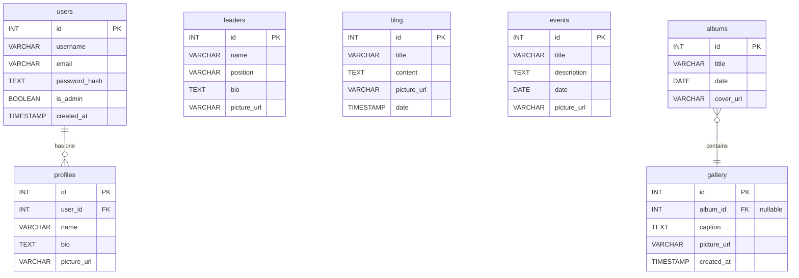

# Project Figures

This file contains text-based representations of the diagrams mentioned in the Final Project Report.

---

### Figure 1: High-Level System Architecture

This diagram illustrates the three-tier architecture of the application, showing the flow of information between the client, the backend server, and the database.

```
+-------------------------------------------------+
|                   End User                      |
| (on Desktop/Laptop Browser)                     |
+-------------------------------------------------+
                 |
                 | HTTPS Requests (e.g., GET, POST)
                 v
+-------------------------------------------------+
|             PRESENTATION LAYER                  |
|    - Frontend: React Web Application (Vite)     |
|    - Hosted on Render                            |
|    - Renders UI, handles user input             |
|    - UI built with Material-UI (MUI)            |
+-------------------------------------------------+
                 |
                 | REST API Calls (Axios)
                 | (e.g., /api/blog, /api/auth/login)
                 v
+-------------------------------------------------+
|                 LOGIC LAYER                     |
|     - Backend: Node.js + Express Server         |
|     - Hosted on Render                          |
|     - Handles business logic, auth, validation  |
|     - Serves static assets (uploads)            |
+-------------------------------------------------+
                 |
                 | SQL Queries (pg library)
                 | (e.g., SELECT *, INSERT ...)
                 v
+-------------------------------------------------+
|                   DATA LAYER                    |
|      - Database: PostgreSQL on Render           |
|      - Stores all persistent application data   |
|      - (users, blog, events, gallery, etc.)     |
+-------------------------------------------------+
```

---

### Figure 2: Frontend Component Hierarchy

This diagram shows the structural composition of the main React components on the frontend, illustrating how pages are built from smaller, reusable parts.

```
App.jsx
└── AuthProvider
    └── Router
        ├── Navbar.jsx
        │   ├── NavbarBrand.jsx
        │   ├── NavbarLinks.jsx
        │   └── NavbarDrawer.jsx (for mobile)
        │
        ├── main
        │   └── Routes
        │       ├── <Route path="/" element={<Home />} />
        │       ├── <Route path="/blog" element={<Blog />} />
        │       ├── <Route path="/events" element={<Events />} />
        │       ├── <Route path="/gallery" element={<GalleryAlbums />} />
        │       │
        │       ├── <Route path="/login" element={<Login />} />
        │       ├── <Route path="/register" element={<Register />} />
        │       │
        │       └── <Route path="/admin" element={<PrivateRoute adminOnly={true} />}>
        │           │   {/* This wraps the AdminDashboard and its sub-routes/components */}
        │           └── AdminDashboard.jsx
        │               ├── UserManagement.jsx
        │               ├── BlogManagement.jsx
        │               ├── EventManagement.jsx
        │               └── ... (etc.)
        │
        └── Footer.jsx
```

---

### Figure 3: Authentication Flow (JWT)

This sequence diagram illustrates the steps involved when a user logs in to receive a JSON Web Token (JWT) and uses it to access a protected resource.

```
  User (Client)            Frontend Server              Backend API                Database
      |                         |                           |                         |
      |---1. POST /login------>|                           |                         |
      |   (email, password)     |                           |                         |
      |                         |---2. POST /api/auth/login--->|                         |
      |                         |   (email, password)         |                         |
      |                         |                           |---3. Find user by email-->|
      |                         |                           |                         |<--4. Return user record--|
      |                         |                           | (with password hash)    |
      |                         |                           |                         |
      |                         |<--5. Compare hash----------| (bcrypt.compare)        |
      |                         |   (if valid, generate JWT)  |                         |
      |                         |                           |                         |
      |<--6. Return JWT---------|                           |                         |
      |   (Store JWT in         |                           |                         |
      |    localStorage)        |                           |                         |
      |                         |                           |                         |
      |---7. GET /api/profile-->|                           |                         |
      |   (Header: Auth Bearer) |                           |                         |
      |                         |---8. GET /api/profile------>|                         |
      |                         |   (Header: Auth Bearer)   |                         |
      |                         |                           |---9. Verify JWT----------| (auth middleware)
      |                         |                           | (extract user_id)       |
      |                         |                           |                         |
      |                         |                           |---10. Fetch profile----->|
      |                         |                           |                         |<--11. Return profile---|
      |                         |                           |                         |
      |<--12. Return profile----|                           |                         |
      |   (Render profile page) |                           |                         |
      |                         |                           |                         |
```

---

### Figure 4: Database Entity-Relationship Diagram (ERD)

This diagram describes the database schema using Mermaid syntax. You can copy and paste this into a Mermaid-compatible renderer (like the one on GitHub, or live editors online) to generate a visual ERD.


